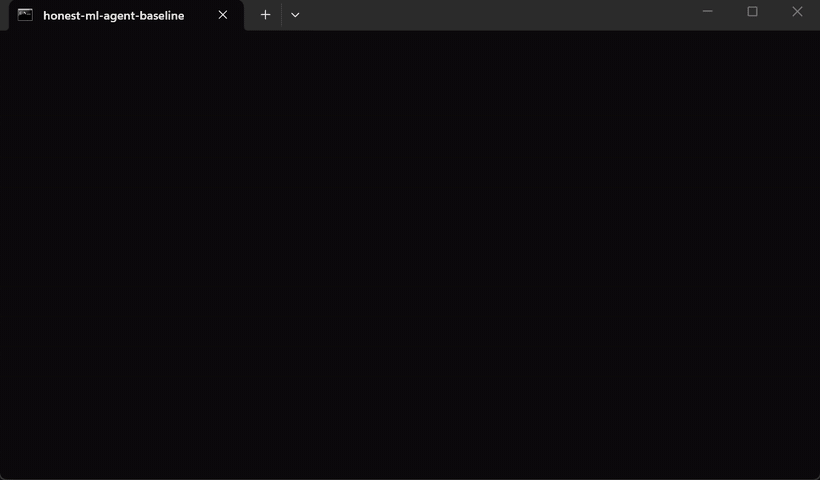

<div align="center">

# honest-ml

**Your AI agent's model is lying to you.**

Agent skills that stop Claude Code, Codex, and Cursor from shipping ML results that look great and mean nothing.



<sub>A real, unscripted screen recording: Claude Code (Opus 5.5) gets the same prompt twice, first with no skills, then with honest-ml. Sped up 5x. Raw transcripts: <a href="assets/runs/">assets/runs/</a>.</sub>

</div>

## What changes

Same prompt, same model, same data (`train.csv` and `test.csv` with four planted leaks), taken from the recording above:

| | Without honest-ml | With honest-ml |
|---|---|---|
| Spotted that `cancellation_reason` gives the label away | yes | yes |
| Dropped the id column | yes | yes |
| Picked the model on train data only | yes, plain 5-fold CV | yes, customer-grouped CV over 3 seeds |
| Reported result | **0.685** AUC, a single number | **0.68** AUC, **95% CI [0.63, 0.72]**, customers resampled |
| Baseline row (constant score) and PR-AUC | no | yes (PR-AUC 0.33 vs a 0.19 churn rate) |
| Measured what the leak would have scored | yes: 1.0 | yes: 1.000 with it, 0.679 without |
| 60 test rows duplicated in train | not mentioned | found, removed, effect measured |
| "Random split is optimistic" caveat | not mentioned | flagged: AUC 0.53 on test customers unseen in train (n=87, noisy) |
| Questions for the data owner | no | yes |
| Time taken | 55 s | 103 s |

**Honest note.** A strong agent already catches the *obvious* leak on its own. Across the three pairs I recorded, the run without the pack always caught `cancellation_reason` and always reported a single number with no interval. The run with the pack always reported an interval and checked more. This is three pairs on one dataset, not a benchmark. Run it yourself: the prompt is in [`assets/runs/baseline.meta.json`](assets/runs/baseline.meta.json).

`1.000 AUC` → **leakage found** → `0.65 AUC, 95% CI [0.62, 0.67], baseline 0.50` is what [`examples/demo_train.py`](examples/demo_train.py) prints without any agent (12 seconds, same data, four evaluation protocols).

---

## The problem

Ask any coding agent to "train a model on this CSV" and you'll often get:

- `fit_transform` on the **whole dataset** before splitting
- shuffled K-fold on **time series**
- the same user in **train and test**
- a feature that **is** the label in disguise
- accuracy on a 95/5 imbalanced dataset, no baseline, one seed, no error bars

…and then a confident *"The model achieves 99% accuracy!"*

These are the same mistakes that sink Kaggle notebooks, papers, and production models. **honest-ml** teaches your agent to catch them automatically.

## The skills

| Skill | What it makes your agent do | Ships with |
|---|---|---|
| 🔍 **[leakage-hunter](skills/leakage-hunter/SKILL.md)** | Hunts train/test contamination, target, temporal, group, and preprocessing leakage before any metric is reported. Opt-in point-in-time check for features backfilled after the decision (needs as-of timestamps). | `leakage_check.py` |
| 📏 **[honest-eval](skills/honest-eval/SKILL.md)** | Baseline first, the right metric, confidence intervals, paired comparisons, test set touched once. | `bootstrap_ci.py` |
| 🧪 **[dataset-audit](skills/dataset-audit/SKILL.md)** | Profiles new data for label noise, missingness, duplicates, unit errors, and train/serve skew before modeling. | `audit.py` |
| 🔁 **[reproducible-runs](skills/reproducible-runs/SKILL.md)** | Seeds, pinned envs, config, data hashes, git SHA, one directory per run, multi-seed results. | `repro.py` |
| 🤖 **[llm-eval](skills/llm-eval/SKILL.md)** | Real eval sets for prompts, RAG, and agents: programmatic graders, checked LLM-as-judge, flip reports, cost and latency. | `run_eval.py` + templates |
| 🔥 **[ml-roast](skills/ml-roast/SKILL.md)** | A blunt, prioritized review of ML code with fixes and a 0-10 trust score. | `roast_scan.py` |

Skills trigger on their own when the agent is doing ML work. You can also call them by name: *"roast my notebook"*, *"run leakage-hunter on this"*.

### How they fit together

```
dataset-audit  ->  leakage-hunter  ->  reproducible-runs  ->  honest-eval
 (is the data       (are the splits      (can it be rerun,     (is the number
  sane?)             clean?)              over several seeds?)  real and big enough?)

                  llm-eval: the same discipline for prompts, RAG and agents
                  ml-roast: reviews any of the above and scores the result 0-10
```

Every script is optional: skills work from the instructions alone, and the scripts make the checks fast and repeatable. The whole pack adds about 620 tokens of always-on context (each skill loads its full text only when it triggers). They need Python 3.9+ with `pandas`, `scikit-learn` and `numpy` (`reproducible-runs`, `llm-eval` and `ml-roast` need less; see each script's header).

## Install

**Claude Code (plugin)**
```bash
/plugin marketplace add moelsaka01/honest-ml
/plugin install honest-ml@honest-ml
```

**Any agent (skills CLI)**
```bash
npx skills add moelsaka01/honest-ml
```

**Manual**
```bash
git clone https://github.com/moelsaka01/honest-ml
cp -r honest-ml/skills/* ~/.claude/skills/      # Claude Code
cp -r honest-ml/skills/* ~/.codex/skills/       # Codex
```

## Try it in 30 seconds

```bash
pip install pandas scikit-learn
python examples/make_leaky_data.py          # demo churn data with four planted leaks
python examples/demo_train.py               # 1.000 AUC -> 0.65: the same data under four protocols
python skills/leakage-hunter/scripts/leakage_check.py \
  --train examples/train.csv --test examples/test.csv \
  --target churned --time signup_date --group customer_id
python skills/dataset-audit/scripts/audit.py --data examples/train.csv \
  --target churned --time signup_date --id customer_id
python skills/ml-roast/scripts/roast_scan.py examples/bad_example.py
```


<sub>Rendered from the real output of the demo by <a href="tools/make_demo_gif.py"><code>tools/make_demo_gif.py</code></a>. The honest AUC moves by about 0.02 between library versions.</sub>

The demo dataset has four planted leaks (7% of test rows duplicated in train, `cancellation_reason` that gives away the label, a shuffled split on time-ordered data, and 583 customers in both sets). The checker finds all four. Then ask your agent to *"train a churn model on examples/"* with and without honest-ml installed and compare what it reports.

## Philosophy

1. **Assume leakage until proven otherwise.** Great numbers are a symptom.
2. **No metric without a baseline and an error bar.**
3. **The test set is sacred.** Touch it once.
4. **Say the uncomfortable thing.** "The model barely beats predicting the mean" is a valid result.

## Development

```bash
pip install pandas scikit-learn numpy
python -m unittest discover -s tests
```

The tests run every script against planted-flaw fixtures, check that the scanner is silent on correct code, and check that each `SKILL.md` is well-formed (front matter, existing script paths, working links, documented examples that match real output). CI runs them on Ubuntu 24.04, Windows and macOS with Python 3.9, 3.10 and 3.12.

### How the recording was made

`tools/record_agent.ps1` (Windows, needs ffmpeg and a logged-in `claude` CLI) opens a terminal window, starts the real agent with the identical prompt, with `--disable-slash-commands` for the baseline and `--plugin-dir .` for honest-ml, and records only that window with ffmpeg. `tools/agent_demo.py` prints the agent's live stream; it masks your home folder and username on screen, and `tools/sanitize_transcript.py` strips machine details from the saved transcripts. Nothing is scripted or edited, and the agent's behaviour is unchanged.

## Contributing

PRs welcome, especially new failure modes with a real-world example of how they burned someone. Each skill is a folder with a `SKILL.md` (short, specific, checkable) and optional `scripts/`. Add a test for any new check, including one that proves it does *not* fire on clean data.

## License

MIT
